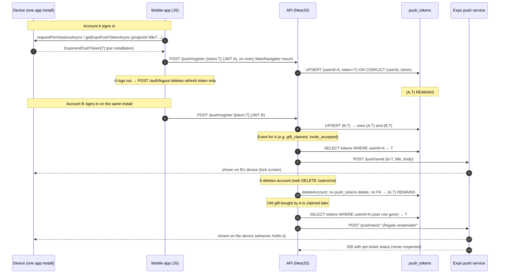

# SP-1: push-token lifecycle and account-deletion privacy (diagnostic and remediation design)

**Mode:** diagnostic and design only.

**Not done:**
- no change to application code, migrations or data;
- no SQL executed against any environment;
- no notification sent;
- no build.

**Recommendations are not approvals.** Implementation needs an independent PA review and a separate PO authorization (§14).

---

## 1. Verified repository baseline (revalidated 2026-11-23)

| Ref | Head | Note |
|---|---|---|
| `main` | `8f2f294` | **Analysis base** |
| PR #78 Checkpoint A | `81143790` | No diff vs `main` in `push/`, `users/users.service.ts`, `gifts/`, `auth/`, mobile `hooks/`, `auth/`, `navigation/`, `api/` |
| PR #82 B2 preparation | `0ad54f75` | §6.1 V-1…V-12, C-1…C-4 (PA-accepted) |
| PR #83 B2-A1 | `0f147359` | Email only; does not touch push, deletion or gifts |
| PR #60 payment lifecycle | `d8e61e24` | Rewrites `fulfillGift` (post-commit closure). `claimGift` and the push call are unchanged in intent; see §9. |
| PRs #66, #75, #80, #81 | `9c9e4903`, `cb953607`, `28aa6680`, `c4106a2b` | No push or deletion changes |

All line references are to `main` @ `8f2f294`.

---

## 2. Lifecycle diagram



---

## 3. Findings with code references

### 3.1 Token ownership and registration

| ID | Finding | Reference |
|---|---|---|
| F-1 | `push_tokens(id, userId uuid NOT NULL, token varchar(255), platform varchar(20), createdAt)`. **No foreign key on `userId`.** Unique `(userId, token)`. Index on `userId` only. **No index on `token` alone.** The composite unique index leads with `userId`, so it can't serve token lookups. | migration `1714000000045-CreatePushTokens.ts:5-16`, `push/push-token.entity.ts` |
| F-2 | `POST /push/register` (`JwtAuthGuard`) passes the inline body type `{ token: string; platform?: string }` to `registerToken`. An inline type carries no class-validator metadata, so the global `ValidationPipe({whitelist:true})` validates nothing. There is no token format check, no length check (over 255 characters gives a DB error, i.e. 500) and no platform check (over 20 characters, same). | `push/push.controller.ts:9-17`, `main.ts:40` |
| F-3 | `registerToken` upserts `(userId, token, platform)` with conflict on `(userId, token)`. It never inspects other users' rows for the same token. **One token can have any number of owners.** | `push/push.service.ts` `registerToken` |
| F-4 | JWT authentication loads the user on every request (`JwtStrategy.validate` → `findById`, 401 if missing). **A deleted account cannot register tokens.** Refresh also re-checks the user. | `auth/jwt.strategy.ts`, `auth/auth.controller.ts:91-110` |
| F-5 | Mobile registers on **every `MainNavigator` mount**, if permission is granted, using `getExpoPushTokenAsync()` with `extra.eas.projectId`. Errors are swallowed. **There is no unregister call anywhere.** The tap handler is a no-op. | `mobile/src/hooks/usePushNotifications.ts:15-34`, `app.config.js` (`extra.eas.projectId`) |

### 3.2 Logout, session expiry and account switching

| ID | Finding | Reference |
|---|---|---|
| F-6 | Mobile `logout()`: `POST /auth/logout` (deletes the refresh token only), then `clearToken()`, then the login screen. **Push registration is untouched** on server and client. | `mobile/src/auth/AuthContext.tsx:18-24`, `api/src/auth/auth.controller.ts:117-128` |
| F-7 | Session expiry: when refresh fails, the API client just throws. There is no logout path, so there is nothing that *could* revoke. | `mobile/src/api/client.ts:20-70` |
| F-8 | Account switch: B's first `MainNavigator` mount registers `(B,T)`; `(A,T)` remains (F-3, F-6). | composition of F-3, F-5, F-6 |

### 3.3 Sending

| ID | Finding | Reference |
|---|---|---|
| F-9 | `sendToUser(userId, …)` selects tokens by `userId`, loads the user only for language, and **sends even if the user row is missing** (`lang = user?.uiLanguage ?? 'es'`). | `push/push.service.ts` `sendToUser` |
| F-10 | `sendExpo` POSTs one message per token without an Expo access token. **The response is never read**, so per-ticket errors such as `DeviceNotRegistered` are ignored and no pruning ever happens. On a network exception it logs `Push failed to ${to}`, which is the full token. | `push/push.service.ts` `sendExpo` |
| F-11 | Callers and recipient sources (summarized in the table below). | `gifts.service.ts:160`, `subscriptions.service.ts:419`, `club-*.service.ts` |
| F-12 | `gift_cards.buyerUserId` has **no foreign key** and survives deletion. `claimGift` sends `gift_claimed` to it. **This is a reachable send to a deleted account's tokens** (PR #82 V-9). | migration `…043-CreateGiftCards.ts`, `gifts.service.ts:128-163` |

Push callers (F-11):

| Push | Recipient | Recipient source | Reaches a deleted account? |
|---|---|---|---|
| `gift_claimed` | Gift buyer | `gift_cards.buyerUserId` | **Yes** |
| `invite_accepted` | Plan owner | `subscriptions.userId` (deleted with the account) | No |
| Club pushes | Members | `club_members` (cascade-deleted) | No |

### 3.4 Account deletion

| ID | Finding | Reference |
|---|---|---|
| F-13 | **Explicit deletes**, then `repo.delete(userId)`, then the farewell email: `user_books`, `token_ledger`, `user_cause_preferences`, `courtesy_token_quotas`, `subscriptions`, and `waitlist_entries` (by email). | `users/users.service.ts:54-76` |
| F-14 | The deletion is **not transactional**: seven separate statements on the default manager. A failure part-way leaves partial deletion. This contradicts the CLAUDE.md rule "use transactions for operations that touch more than one table". | same |
| F-15 | **Mobile has no account-deletion entry point.** Deletion is web-only (`DeleteAccountModal` → `DELETE /users/me`). Out of SP-1 scope; flagged for the PO (app-store account-deletion requirements). | `web/components/DeleteAccountModal.tsx:25`; no mobile caller found |
| F-16 | No Stripe call during deletion. The local `subscriptions` row is deleted, but the Stripe customer and subscription are not cancelled. Already known from the 2026-11-02 ToS audit. Live impact depends on the payment gate, which is off in production. | `users.service.ts` (no Stripe reference) |

Full per-table deletion results are in §10.

---

## 4. Confirmed defects versus hypothetical risks

### 4.1 Confirmed from source (reproducible with unit tests, no device needed)

| ID | Defect | Findings |
|---|---|---|
| **D-1** | One device token can be owned by several accounts at once | F-1, F-3 |
| **D-2** | Logout never revokes the push registration | F-6 |
| **D-3** | Session expiry never revokes (no logout path) | F-7 |
| **D-4** | Account deletion leaves `push_tokens` rows, and there is no FK to cascade | F-1, F-13 |
| **D-5** | A push is **sent** (handed to Expo) for a deleted account when its old gift is claimed | F-9, F-12 |
| **D-6** | `sendToUser` sends to non-existent users | F-9 |
| **D-7** | Expo ticket errors ignored, no pruning; full token logged on network failure | F-10 |
| **D-8** | Registration body unvalidated (format, length, platform); oversized input gives a 500 | F-2 |
| **D-9** | Account deletion not transactional | F-14 |
| **D-10** | Deletion leaves encrypted social OAuth tokens in Redis (until TTL, up to 60 days for refresh) | §10 |
| **D-11** | Deletion leaves public share records and invite pages (`shares.quote`, `/s/<id>`, PNG in the public `images/` bucket) | §10 |
| **D-12** | The ES/EN farewell email's "all your data … erased" claim is inaccurate given D-4, D-10, D-11 and §10 | §10 |

### 4.2 Hypothetical or device-dependent (need device testing or production data)

| ID | Risk | Depends on |
|---|---|---|
| **H-1** | A's notifications are **displayed** to B on a shared device (C-1) | Expo issuing the same token to both sessions on one install. Expo documents tokens as per installation, but this was not device-tested here. |
| **H-2** | A logged-out device keeps displaying the account's notifications (C-3) | Token still valid; OS permission still granted |
| **H-3** | A deleted account's device displays the gift-claimed push (C-2) | App still installed with a valid token; a pre-deletion gift claimed later |
| **H-4** | Token hijack: an authenticated attacker registers a victim's token and directs the attacker's own notifications to the victim's device (C-4). Under remediation Option A this could also **evict** the victim (§6). | Knowing the victim's token. Tokens are unguessable but are logged by D-7. |
| **H-5** | Rate of invalid or expired tokens in production | Expo responses; production data (SQL in §7.3) |
| **H-6** | Stripe keeps billing a deleted user (F-16) | Payments being activated; out of SP-1 scope |
| **H-7** | Whether any real devices are registered at all | Production data (SQL §7.3) and the released mobile build history (PO knowledge) |

**About the Expo token.** Expo push tokens are bearer-like: without Expo's optional "enhanced push security" access token, anyone holding a token can send notifications to that device under the app's identity. That makes logging them (D-7) and accepting arbitrary values (D-8) more serious than the raw strings suggest.

---

## 5. Remediation options and trade-offs

| Option | What | Fixes | Trade-offs |
|---|---|---|---|
| **A**: server-side single owner | On `register(user, T)`, inside one transaction: remove every row for `T` with `userId ≠ user`, then upsert `(user, T)` | D-1. D-2 and D-3 at the moment the next account registers. H-1 after B's first launch. | **No migration needed** if concurrency is serialized with `pg_advisory_xact_lock(hashtext(T))`. Without the lock, two concurrent registrations each delete the other's row and both insert, leaving two owners. The DB-enforced alternative is a unique index on `token` plus `ON CONFLICT (token) DO UPDATE SET "userId" = EXCLUDED."userId"`, which is atomic but needs a migration and a de-duplication step first (§8). Leaves a window between A's logout and B's login. Increases the impact of H-4 (eviction), so pair it with D-8 validation and no token logging. |
| **B**: logout revocation | New `DELETE /push/register` (or `POST /push/unregister {token}`), authenticated; deletes `(caller, T)` only. Mobile `logout()` calls it **before** clearing tokens. | D-2 (closes the A-logout → B-login window); C-3 | **Needs a mobile change.** It is JS-only, so OTA-eligible per CLAUDE.md, but OTA and builds need separate authorization. Offline logout or a failed call leaves the row, so A is still needed. Older installed versions never call it, so A is still needed. Doesn't cover session expiry (D-3) unless also wired to the refresh-failure path. |
| **C**: deletion cleanup | `DELETE FROM push_tokens WHERE "userId" = $1` inside `deleteAccount`, and make `deleteAccount` one transaction (D-9) | D-4, D-5 (by removing the tokens) | Explicit cleanup covers only this code path. An FK `ON DELETE CASCADE` also covers manual or admin deletes, but needs a migration and requires removing existing orphans first, otherwise the `ALTER TABLE` fails (§8). |
| **D**: send-time protection | In `sendToUser`, return without sending when the user row is missing (the row is already loaded) | D-6, D-5 (even with orphans present) | About 3 lines, no schema change. Defence in depth: it does not remove the retained tokens (D-4 still applies to data retention). |
| **E**: invalid-token pruning | Read the Expo response. For tickets with `details.error === 'DeviceNotRegistered'`, delete that `(userId, token)` row. Log the ticket status and a **redacted** token (prefix plus hash), never the full token. | D-7, H-5 | No retries and no extra network calls (ticket errors come back in the same response). Delayed **receipt** errors need a second call about 15 minutes later, i.e. a scheduled job. **Not recommended now:** it is new operational machinery, and ticket-level pruning covers the common case. |

---

## 6. Recommended minimal architecture

**Recommendation** (pending PA review and PO decision):

- **Phase 1** (server only, no migration, no mobile release): **A** (transaction + advisory lock) + **C** (explicit cleanup + transactional `deleteAccount`) + **D** + **E-lite** (tickets only, redacted logging) + **D-8 validation** (a class DTO for `/push/register`: Expo token pattern `^Expo(nent)?PushToken\[[^\]]+\]$`, max 255; platform in `ios | android | web | unknown`).
  - This closes D-1 and D-4 to D-8 for **all installed app versions**, with no data migration.
  - The remaining exposure is the window between A's logout and the next login on the device (H-2), and D-3.
- **Phase 2** (needs a mobile OTA, separately authorized): **B**, with `logout()` calling unregister before clearing local tokens. Optionally also on refresh failure.
- **Phase 3** (optional, needs migration and data authorization):
  - remove existing orphans (§7.3 counts first);
  - add an FK `push_tokens.userId → users(id) ON DELETE CASCADE`;
  - optionally replace the uniqueness model with `UNIQUE(token)`, which makes Option A DB-enforced.
  - Only worthwhile if the PO wants protection beyond the code path, or the orphan counts are material.

**Why not everything:** B needs a mobile release. A unique-token migration needs de-duplication of live data. Receipt polling adds infrastructure. A + C + D + E-lite gives account isolation and deletion correctness for push without any of those.

**Separate from push (D-9 to D-12):**
- D-9, the transactional deletion, is folded into Option C because it is the same function.
- D-10 (Redis social tokens) and D-11 (shares) are deletion-completeness items that need the retention decisions in §12. They are **not** part of the minimal push fix.

---

## 7. Security and regression test plan

### 7.1 Unit tests (API, jest)

All tests mock the repositories or query runner and mock `fetch`. No network, no database.

| # | Scenario (PO list) | Test | Expected after remediation | Today |
|---|---|---|---|---|
| 1 | A registers T | `registerToken(A,T)` | one row `(A,T)` | same |
| 2 | B registers the same T | `registerToken(B,T)` after 1 | rows: `(B,T)` only; `(A,T)` removed inside the same transaction under the lock | `(A,T)` and `(B,T)` (**fails**) |
| 3 | A logs out | `unregister(A,T)` (Phase 2) / no-op (Phase 1) | `(A,T)` absent | present |
| 4 | B receives its own, not A's | `sendToUser(A)` → no Expo call to T; `sendToUser(B)` → one call to T | as stated | A's push goes to T (**fails**) |
| 5 | A deleted | `deleteAccount(A)` | `DELETE push_tokens WHERE userId=A` executed in the deletion transaction; rollback on failure leaves everything | no delete (**fails**) |
| 6 | Old gift of A claimed | `claimGift` with `buyerUserId=A`, user missing | gift claimed and tokens credited (**unchanged**); `sendToUser` returns before any `fetch` | push sent (**fails**) |
| 7 | No push to A's devices | as 6, plus orphan `(A,T)` still present (simulating legacy data) | still no `fetch` (Option D) | **fails** |
| 8 | Invalid Expo token | `fetch` resolves `{data:[{status:'error',details:{error:'DeviceNotRegistered'}}]}` | row deleted; log contains no full token; other errors kept and logged redacted | ignored (**fails**) |
| 8b | Network failure | `fetch` rejects | swallowed; log redacted | full token logged (**fails**) |
| 9 | Concurrent registrations | Two `registerToken` calls for T with interleaved query mocks; assert the advisory lock is taken in both, and the delete-then-upsert runs inside each transaction | at most one owner | n/a |
| 9b | Concurrency in real Postgres | Integration test against a disposable local Postgres (docker compose dev DB, **not** staging or prod) running two parallel transactions | exactly one row for T | — (optional; existing dev tooling only) |
| 10 | Existing types still work | P-1 `invite_accepted`, P-2 `gift_claimed` (buyer exists), P-3 to P-5 club types | identical Expo payloads to today (golden master of the request body, captured first) | baseline |
| 11 | Validation | malformed token, over 255 characters, unknown platform | 400, no DB write | 500 or stored (**fails**) |
| 12 | Isolation | `unregister(B, T_ofA)` | deletes nothing of A's | n/a |

### 7.2 Device tests (manual; separately authorized; test accounts only)

Run these on a development or preview build against **staging**, never production:

1. H-1: two accounts on one install.
2. Logout window (H-2).
3. Deleted-account gift claim (H-3).
4. Behaviour of older app versions.

They need a staging push setup and test sends, which are prohibited under this mission.

### 7.3 Read-only SQL diagnostic plan

**Not executed.** The PO runs it on production when authorized. It returns aggregates only and never selects token values or email addresses.

```sql
BEGIN TRANSACTION READ ONLY;
-- Q1 orphaned push registrations (user deleted)
SELECT count(*) AS orphan_tokens FROM push_tokens pt
 WHERE NOT EXISTS (SELECT 1 FROM users u WHERE u.id = pt."userId");
-- Q2 tokens with more than one owner, and the size distribution
SELECT owners, count(*) AS tokens FROM (
  SELECT token, count(DISTINCT "userId") AS owners FROM push_tokens GROUP BY token) t
 WHERE owners > 1 GROUP BY owners ORDER BY owners;
-- Q3 registrations per user (heavy multi-device or stale accumulation)
SELECT n AS tokens_per_user, count(*) AS users FROM (
  SELECT "userId", count(*) AS n FROM push_tokens GROUP BY "userId") t GROUP BY n ORDER BY n;
-- Q4 malformed tokens and platform mix
SELECT platform, (token ~ '^Expo(nent)?PushToken\[[^]]+\]$') AS well_formed, count(*)
  FROM push_tokens GROUP BY 1, 2 ORDER BY 1, 2;
-- Q5 age profile
SELECT date_trunc('month', "createdAt") AS month, count(*) FROM push_tokens GROUP BY 1 ORDER BY 1;
-- Q6 gifts whose buyer no longer exists, and how many could still trigger a push (D-5)
SELECT g.status, (g."expiresAt" > now()) AS claimable, count(*)
  FROM gift_cards g
 WHERE g."buyerUserId" IS NOT NULL
   AND NOT EXISTS (SELECT 1 FROM users u WHERE u.id = g."buyerUserId")
 GROUP BY 1, 2;
-- Q7 other deletion residue (ids only, counts)
SELECT 'gift_cards.claimedByUserId' AS ref, count(*) FROM gift_cards g WHERE g."claimedByUserId" IS NOT NULL AND NOT EXISTS (SELECT 1 FROM users u WHERE u.id = g."claimedByUserId")
UNION ALL SELECT 'shares.createdById', count(*) FROM shares s WHERE s."createdById" IS NOT NULL AND NOT EXISTS (SELECT 1 FROM users u WHERE u.id = s."createdById")
UNION ALL SELECT 'upload_codes.createdById', count(*) FROM upload_codes c WHERE NOT EXISTS (SELECT 1 FROM users u WHERE u.id = c."createdById")
UNION ALL SELECT 'upload_codes.usedBy', count(*) FROM upload_codes c WHERE c."usedBy" IS NOT NULL AND NOT EXISTS (SELECT 1 FROM users u WHERE u.id = c."usedBy")
UNION ALL SELECT 'events.user_id NULL (pseudonymized)', count(*) FROM events WHERE user_id IS NULL;
ROLLBACK;
```

Redis residue (D-10) can be sized only with `SCAN` over `social:tokens:*` keys and a comparison against existing users. That is read-only, but it is still a production operation, so it is listed for the PO and **not** proposed for execution here.

---

## 8. Database impact and migration assessment

| Change | Migration? | Data change? | Risk | Note |
|---|---|---|---|---|
| Option A with advisory lock | No | Deletes duplicate-owner rows **only when the token is next registered** (organic) | Low | Uses the existing `(userId, token)` unique index for the upsert. The token-lookup delete is a sequential scan on a small table (Q3 and Q5 size it). An index on `token` would help but is a migration. |
| Option C (explicit) | No | Deletes only the departing user's rows | Low | Inside the new deletion transaction |
| Option D, E-lite, validation | No | E-lite deletes rows Expo reports as `DeviceNotRegistered` | Low | |
| Index on `push_tokens(token)` | **Yes** | No | Low | Optional performance |
| FK `push_tokens.userId → users ON DELETE CASCADE` | **Yes** | **Requires deleting orphans first** (Q1) | Medium | Protected schema change: needs a snapshot per CLAUDE.md, `COUNT` before `DELETE`, and a transaction |
| `UNIQUE(token)` replacing `(userId, token)` | **Yes** | **Requires de-duplicating multi-owner tokens** (Q2). Which owner is kept is a PO decision (most recent `createdAt` recommended). | Medium | Makes Option A DB-enforced |
| One-time orphan clean-up | Data migration | Deletes Q1 rows | Low–medium | **PO decision.** Option D makes orphans inert in the meantime. |

Any migration follows CLAUDE.md:
- never edit a shipped migration;
- seed or data steps idempotent;
- snapshot before schema changes;
- staging first.

---

## 9. Backward-compatibility analysis

- **Installed mobile versions** (any build that registers tokens): Phase 1 is server-only. The `POST /push/register` contract is unchanged for valid Expo tokens, so old apps keep working.
  - Validation rejects only malformed values. Q4 measures whether any stored token would fail the pattern; if Q4 shows malformed rows from real clients, the pattern is relaxed before shipping.
  - Older apps never call unregister, so they rely on A, C and D, which work for them.
- **Logout (Phase 2):** a new endpoint is additive. New app versions call it; old versions don't. A server without it (if the app is updated first) returns 404, which the app swallows.
- **Notification payloads:** unchanged (test 10 golden master). The B2-B work (PR #82) is independent. **SP-1 Phase 1 should precede B2-B2's club copy**, because new club copy increases the H-1 exposure.
- **PR #60:** changes `fulfillGift` but not `claimGift`'s push call. Option D lives in `PushService`, so there is no conflict. Option C touches `users.service.ts`, which #60 does not change.
- **PR #83 (B2-A1):** no overlap. B2-A1 is email only; the farewell email text is unchanged in both.
- **Web:** no change (web doesn't register push).

---

## 10. Account-deletion and retention findings

Legend for the **Proposed class** column (all classes are proposals):

| Class | Meaning |
|---|---|
| **Delete** | Must be deleted |
| **Retain** | Legitimate retention (financial, legal or security) |
| **Anonymize** | Separate from identity |
| **Unintended** | Retained by accident |
| **Over-delete** | Deletes other people's data |

**Recommendation:** none of these classifications is a decision. Financial and legal retention needs explicit PO and legal input.

| Data | Today on deletion | Proposed class | Note |
|---|---|---|---|
| `users` row (email, name, password hash, `stripeCustomerId`, preferences) | Deleted | Delete | — |
| `reading_progress`, `fragments`, `reading_stats`, `user_personas`, `user_books`, `user_cause_preferences`, `token_ledger`, `courtesy_token_quotas` | Deleted (explicit and/or FK cascade) | Delete | `token_ledger` holds token purchase and expiry history. Whether any of it is a financial record to retain is a **PO/legal question**: Stripe holds the payment records. |
| `subscriptions` (+ `subscription_invites` by cascade) | Deleted locally. **Stripe not cancelled** (F-16). | Delete locally; Stripe handling is a decision | Out of SP-1 scope; tracked in ToS audit and PR #60 |
| `push_tokens` | **Retained, no FK** | **Unintended → Delete** | D-4 |
| `gift_cards` where the user is buyer (`buyerUserId`, `buyerEmail`) | **Retained** | **Retain the transaction, anonymize identity** (proposal): keep amount, token count, status, `stripeSessionId` and dates; null `buyerUserId`; null or hash `buyerEmail` | The recipient may still need to claim an unclaimed gift, which must keep working (the claim needs only `claimToken`). Accounting retention is a PO/legal decision. |
| `gift_cards` where the user is recipient (`recipientEmail`, `claimedByUserId`) | **Retained** | Same proposal: keep the record; null `claimedByUserId`; `recipientEmail` needs a decision | Removing `recipientEmail` from **sent but unclaimed** gifts would break the buyer's purchase; only claimed or expired gifts can be anonymized. **Decision.** |
| `subscription_invites.invitedEmail` from **other** users' plans to this email | Retained | Expire naturally (48 h) or delete pending by email | Minor |
| `shares` (`createdById`, `quote` text copied from the fragment, public `/s/<id>` page, PNG in the public `images/` bucket) | **Retained and publicly reachable** | **Decision:** delete, or keep as anonymous public content | D-11. The fragment itself is deleted, but the shared copy stays live. |
| User-uploaded quote-card backgrounds (public bucket) | Retained | Unintended → Delete (decision) | No user linkage stored in DB rows; needs a storage-key convention check |
| `events` (`user_id` → SET NULL; payload has `fragmentId`, `themes`, `platform`, `textLength`, no text) | Retained, pseudonymized | Anonymize (current behaviour acceptable) | Dangling `fragmentId` only |
| `books.uploadedById` (author uploads) | Retained, set NULL | **Retain** | Readers' permanent ownership (protected policy) requires books to survive |
| `upload_codes.createdById`, `usedBy` (no FK) | Retained | Anonymize or decide | Admin/author tooling |
| Clubs **owned** by the user (`clubs.ownerId` CASCADE) | **The whole club is deleted**, including other members' discussions, messages, polls and sessions | **Over-delete → decision** | Also `club_books.addedById`, `club_polls.createdById` and `club_sessions.hostId` CASCADE, which delete shared club artefacts in clubs the user doesn't own. Data-integrity issue for other users; not a privacy gap. |
| Redis `social:tokens:<userId>:*` (encrypted third-party OAuth tokens) | **Retained until TTL** (refresh up to 60 days) | **Unintended → Delete** | D-10. Third-party credentials should not outlive the account. |
| Redis `refresh:<userId>:*` | Retained until TTL (30 days) | Unintended (harmless) → Delete | Unusable: refresh re-checks the user (F-4) |
| Redis `pwd_reset:*`, `email_confirm:*` | TTL ≤ 24 h | Acceptable | Consuming one fails at user lookup |
| Stripe customer and subscription (external) | Not touched | Decision (outside SP-1) | F-16, H-6 |

### Comparison with the ES/EN deletion email

The email (E-4) says: *"All your data — fragments, library, and preferences — has been erased from our systems"*. The Spanish version says the same: *"Todos tus datos — fragmentos, biblioteca y preferencias — han sido borrados de nuestros sistemas"*.

| Claim | Accurate today? |
|---|---|
| Fragments | Rows yes. **Shared quote copies and public pages no** (D-11). |
| Library | Yes (`user_books`, `reading_progress`) |
| Preferences | Yes (`users` row, cause preferences) |
| "All your data … from our systems" | **No**: push tokens (D-4), gift records with email addresses, Redis OAuth tokens (D-10), shares (D-11), uploaded backgrounds, upload codes, and the external Stripe customer remain |

**No copy is rewritten here.**
- After remediation, some retention will be legitimate (gift and financial records), so the claim needs **legal-reviewed wording** even after every unintended item is fixed. That is a PO/legal decision.
- French E-4 stays release-blocked (PR #82 B2-D5).

---

## 11. Estimated effort and operational costs

| Package | Effort | Notes |
|---|---|---|
| Phase 1: A + C (+ transactional `deleteAccount`) + D + E-lite + validation + tests 1–12 | **≈ 2–3 days** | Server only; no migration |
| Phase 2: B (endpoint + mobile logout call + tests) | ≈ 1 day + OTA/build authorization | JS-only, OTA-eligible |
| Phase 3: migrations (FK cascade, optional `UNIQUE(token)`, orphan clean-up) | ≈ 1–1.5 days + snapshot + staging run | Protected schema/data change |
| Deletion completeness (D-10 Redis, D-11 shares, gift anonymization, club over-delete policy) | ≈ 2–4 days, depending on decisions | Separate decisions; may be a separate mission |
| Device verification (§7.2) | ≈ 0.5 day | Test accounts, staging |

**Operational cost:** none expected.
- Expo push is free.
- No new infrastructure, dependency or vendor.
- Receipt polling (rejected for now) would need a scheduler.

---

## 12. Outstanding PO decisions

None of these is approved.

| ID | Decision | Options | Recommendation |
|---|---|---|---|
| SP-D1 | Token ownership policy | (a) single owner per device token, last registrant wins; (b) multiple owners (today) | **(a)** |
| SP-D2 | Logout revocation semantics | (a) revoke on explicit logout (Phase 2, mobile OTA); (b) also on session expiry; (c) server-side only (rely on A) | **(a)** first, after Phase 1. (b) optional. |
| SP-D3 | Database changes | (a) none (Phase 1 only); (b) FK cascade; (c) FK + `UNIQUE(token)` | **(a)** now. Revisit with Q1–Q3 counts. |
| SP-D4 | Existing orphaned tokens | (a) leave inert behind Option D; (b) one-time delete after counts | **(b)** after Q1, under a separate data authorization |
| SP-D5 | Gift-record retention and anonymization | keep, anonymize or delete, per role (buyer, recipient) and status (unclaimed, claimed, expired) | Keep transactions; anonymize identities where the gift is claimed or expired; legal review |
| SP-D6 | Shares and public pages after deletion | delete; keep anonymized | Decision needed (D-11) |
| SP-D7 | Club over-deletion on owner deletion | keep cascade; transfer ownership; soft-delete | Decision needed (product) |
| SP-D8 | Deletion-email wording (ES/EN, and French later) | legal rewording after remediation | Legal review; no change before decisions |
| SP-D9 | Mobile update | authorize OTA (JS-only) for Phase 2 | After Phase 1 is accepted |
| SP-D10 | Redis third-party token clean-up on deletion | delete `social:tokens:<id>:*` | **Delete** (fits the Phase 1 deletion transaction, executed after commit) |
| SP-D11 | Mobile in-app account deletion (F-15) | add; keep web-only | Out of SP-1; flag for store compliance |

---

## 13. Explicit STOP conditions (for any future implementation)

STOP and report if any of the following happens:

- a fix needs a migration, a data deletion or orphan clean-up that isn't separately authorized;
- Option A can't be made race-free without a schema change (then present the `UNIQUE(token)` path for decision);
- validation would reject a token format observed from real clients (Q4);
- deletion changes would touch gift, subscription or Stripe semantics, or financial records, beyond the SP-D5 decision;
- the deletion email wording would have to change;
- any change to push payloads or notification copy (B2-B territory);
- a mobile change requires a native build rather than OTA;
- tests would need real Expo sends, staging or production data;
- the deletion transaction would alter the order or atomicity of the farewell email (it must stay best-effort and after commit).

---

## 14. Proposed bounded implementation mission (for PO consideration)

**SP-1-I1: push-token isolation and deletion cleanup (server only).**

- **Scope:** Phase 1 only:
  - Option A (transaction + advisory lock);
  - Option C (explicit `push_tokens` delete; `deleteAccount` in a single transaction; farewell email after commit, unchanged);
  - Option D;
  - E-lite (ticket parsing, `DeviceNotRegistered` pruning, redacted logging);
  - a `RegisterPushTokenDto` with validation;
  - SP-D10 Redis social-token deletion, if approved.
- **Tests:** §7.1 1–12, with a golden master of the Expo request bodies captured first.
- **Out of scope:** Phase 2 (mobile), Phase 3 (migrations or data clean-up), gift anonymization, shares, clubs, Stripe, email copy, B2-B.
- **Deliverables:** Draft PR targeting `main` (not NEM-025-stacked), the test evidence, and the §7.3 SQL for the PO to run before or after deploy.
- **Prerequisites:** PA acceptance of this report; PO decisions SP-D1 and SP-D3 (and SP-D10 if included).
- **STOP:** after implementation, for PA review. No merge or deploy without separate authorization.

---

**Prohibitions observed in this mission:**
- no application code, migration, data or legal-copy change;
- no SQL executed;
- no notification sent;
- no build or OTA;
- no dependency or expense;
- no merge;
- no B2-A2 or B2-B work;
- French and payments untouched.

**STOP FOR INDEPENDENT PA REVIEW BEFORE ANY REMEDIATION.**
